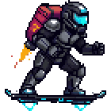

  

  <a href="https://guavovic.vercel.app">Site</a> · <a href="mailto:gustavo.victor.pinheiro@gmail.com">E-mail</a>

# Olá, eu sou o Gustavo 👋

Desenvolvedor de software. Nas horas vagas, faço jogos.

### Projetos

 **[Hoploop](https://hoploop.app)**: mantém suas playlists iguais em todas as plataformas de música. 
 **[achaí-API](https://github.com/guavovic/achai-api)**: busca endereços do Brasil pelo CEP ou pelo nome da rua. 
 **[Vera](https://github.com/guavovic/vera)**: app que fala o que a câmera está vendo, para pessoas cegas e com baixa visão. 
 **Hover Punk**: jogo de ação 2D em pixel art. Em breve. 
 **[ASCII Video Player](https://github.com/guavovic/ascii-video-player)**: toca vídeos no terminal em arte ASCII colorida. 
 **[Mode 7 City](https://github.com/guavovic/mode-7-city)**: city builder em 16 bits inspirado no SimCity de Super Nintendo. 
 **[Paralaxe](https://github.com/guavovic/paralaxe)**: pacote para a Unity que monta cenários com parallax. 
 **[Ponto Facial](https://github.com/guavovic/ponto-facial)**: registro de ponto pelo reconhecimento facial.

### Tecnologias

  
  
  
  
  
  
  
  
  
  

